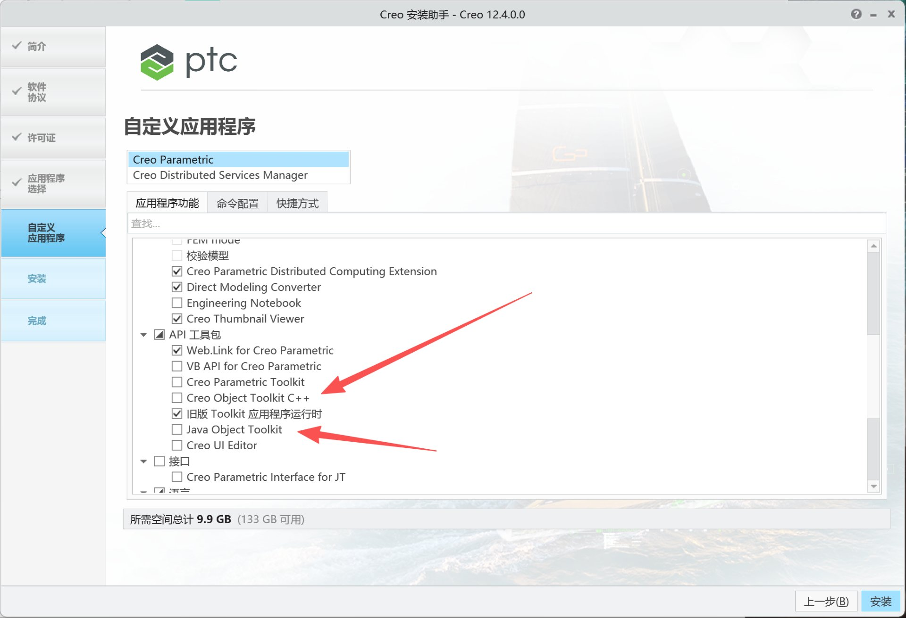

# creo-jlink-toolkit


Creo 有两套官方自动化接口：**J-Link**（Java）和 **Pro/TOOLKIT**（C）。两套都是本地 API——只能在装了 Creo 的机器上调，而且都得写代码。本项目把这两个接口做成两个产物：**一个 HTTP 服务，一个 job 文件**。

> 一个常驻、一个跑批。会发 HTTP 就能驱动 Creo，批量活写成文本文件丢给无头 Creo 跑完就走。

## 这个项目解决什么问题

Creo 的两套接口都只解决了「能调」，不管「好用」：J-Link 要配 Java 环境建工程，Pro/TOOLKIT 要配 C 编译器写回调，而且两头都是 raw SDK。本项目各包了一层：

- **J-Link 包成 HTTP 常驻服务**：任何语言、任何工具（包括 AI Agent）都能直接调 Creo——不用装 JDK、不用建 Java 工程
- **Pro/TOOLKIT 包成 job 文件驱动的离线作业**：写几行文本作业，无头 Creo 启动后自动逐条执行，批量活一次跑完
- **全程不碰 Creo 界面、不学 PTC 的 SDK**——调 HTTP 或写文本文件就行

## J-Link：Java 侧的常驻服务

J-Link 是 PTC 的 Java 接口，把 Creo 内部对象（Session、Model、Parameter、Assembly…）包成 Java 类，能自己拉起一个可靠的 Creo 会话。本项目把它包成 HTTP 服务，常驻 `:8080`，每种能力对应一个端点，当前 21 个：

- **通信**：连接已开的 Creo（`/connect`）或让服务自己拉起无头会话（`/start`）、断开、健康检查
- **查询**：列出会话里的所有模型、当前模型详情、读/写参数、材料、BOM、递归 BOM 树
- **输出**：STEP / IGES 导出（可挂导出配置）、当前视图 JPEG 截图

## C Pro/TOOLKIT：C 侧的离线作业

Pro/TOOLKIT 是 PTC 的 C 接口，能力面最全（干涉检查、装配打平、工程图、进程内读文件），但要写 C、配编译器，冷启动一次 10-15 秒。本项目把常用能力**编成 DLL（已编好，不需要编译器）**，做成 job 文件驱动：一行一个作业，无头 Creo 启动后依次执行，全部跑完一起交结果。

- **适合**：批量、定时、机房里跑的活——几百个模型批量导 STEP、全装配干涉检查、批量出 DWG
- **配合**：一次拉起、全部跑完再退；多类作业可以写进同一个 job 文件
- **独占**：有的能力只有进程内才做得了——参数删除/精确改类型、装配打平、读透明加密（DLP）下的文件

## 能力对照

常见需求一览，✅ 表示该侧原生支持，— 表示该侧不支持。

| 能力 | J-Link 侧（HTTP） | C 同步侧（job） |
|---|---|---|
| STEP / IGES 导出（AP203/214/242） | ✅ | ✅ |
| 模型查询（会话列表 / 当前模型） | ✅ | — |
| 参数读 / 写 | ✅ | ✅ |
| BOM / 递归 BOM 树 | ✅ | — |
| JPEG 截图 | ✅ | — |
| 工程图 DWG / DXF | — | ✅ |
| 干涉检查 + 逐对体积 | — | ✅ |
| 装配打平（FLATTEN / FLATASM） | — | ✅ |
| 公用名称读写（Common Name） | — | ✅ |
| 参数删除 / 类型变更（PARAMDEL/PARAMSET） | — | ✅ |
| 参数表导出（含来源/指定/访问列） | — | ✅ |
| 模型改名（版本链跟随） | ✅ | ✅ |
| 宏命令触发（QUICKDRAW 快速出图） | — | ✅ |
| 配置选项读写（GETOPT/SETOPT） | — | ✅ |
| 透明加密（DLP）环境读文件 | — | ✅ |

一句话：**能用 J-Link 就用 J-Link**，C 侧留给 J-Link 干不了的活。两条通道同一时刻只能用一条——服务连着会话时不要再起同步作业。

## 连上 Creo 之后能做什么

`/connect`（或 `/start`）之后，整个模型会话归你调。按事情类型分三类：

### 查和改（交互型，走 J-Link / HTTP）

- 查看会话里有哪些模型、当前打开的是哪个
- 查看模型的全部参数 / 单个参数，修改参数值和类型
- 查材料属性、改配置选项
- 拉装配 BOM：一级结构、整棵递归树（带公用名称）
- 打开、保存、擦除、显示、重命名模型

### 导出（单件或批量）

- 导 3D 中间格式：STEP（AP203 / AP214 / AP242）、IGES——挂一份导出配置，几百个模型批量跑
- 导工程图：DWG / DXF，一次一批
- 出图/截图：当前视图导 JPEG（网页预览用）；PiCreo 环境下触发「快速出图」等 PDF
- 装配打平后导出：STEP 装配 → 打平成一层 → 再导出（给 3D 打印、轻量化预览、下游系统）

### 检查和盘点（批处理型，走 C 同步侧）

- 全装配干涉检查：零件级 / 子装配级，可只出干涉对清单，也可逐对算干涉体积
- 导参数表：把「工具 → 参数」那张表整个导出来（含来源 / 指定 / 访问列），用于核对
- 导装配清单：BOM 树落成文件，供 PDM / ERP 对接
- 加密环境（DLP / 透明加密）下读文件内容做校验——同步引擎在 Creo 进程内读，不受加密干扰

## 安装

不用自己动手。把压缩包丢给 AI，让它按 `docs/INSTALL.md` 装，装完跑通四项自检就行——见下面「怎么让 AI 装」。唯一需要你亲手准备的是下面两个「自备件」。

### 需要自备的东西

| 缺什么 | 从哪来 | 放哪 |
|---|---|---|
| JRE 11+ | [Adoptium Temurin 11](https://adoptium.net/temurin/releases/?version=11) 官网下载 | 解压到 `jlink/runtime/` |
| `pfcasync.jar` + `otk.jar` | 本机 Creo 安装目录（见下） | 复制到 `jlink/lib/` |
| Creo 本体 + 授权 | 正版安装 | 路径填进 `configure.ps1` |

### otk.jar / pfcasync.jar 怎么获取（重点）

这两个 jar 是 PTC 的 Java 接口库，**装 Creo 时默认不装**，要在安装时手动勾选组件。分两种情况：

**情况一：这台电脑还没装 / 可以重装 Creo**

1. 打开 Creo 安装助手，走到「自定义应用程序」这一步
2. 选中 **Creo Parametric** → 「应用程序功能」页签
3. 展开 **API 工具包**，勾选 **Java Object Toolkit**（就是下图红箭头指的那个，装了它才有 `otk.jar`；勾「旧版 Toolkit 应用程序运行时」也建议勾上）
4. 继续装完。装好后 jar 就在这个目录：

```text
<Creo 安装目录>\Common Files\text\java\
├── otk.jar
└── pfcasync.jar
```



**情况二：这台电脑不方便重装 Creo**

在**另一台电脑**上装 Creo 时按上面勾好组件（Creo 大版本要和你的一致，比如都是 Creo 9），装完让 AI 把这两个文件提取出来：

```text
帮我从 <Creo目录>\Common Files\text\java\ 里把 otk.jar 和 pfcasync.jar
复制出来，放到本包 jlink\lib\ 目录下。
```

> 注意：jar 的版本要和运行 Creo 的机器上的版本一致（同为 Creo 9 就没问题），混用不同版本启动会报 `UnsatisfiedLinkError`。

拿到两个 jar 后丢进 `jlink/lib/`，再把 JRE 解压到 `jlink/runtime/`，剩下的全部交给 AI。

## 怎么让 AI 装

新用户可以不碰终端。把 Release 里的 zip 解压后，整个文件夹丢给会执行任务的 AI（Claude Code、Codex CLI 等），说一句：

```text
解压 creo-jlink-toolkit-v1.4.0.zip 到 D:\creo-jlink-toolkit。
按 docs/INSTALL.md 一节一节装，Creo 装在 <你的 Creo 路径>，授权文件在 <license 路径>。
每节末尾的验证过了再往下走，装完跑通四项自检：
/health、/connect、/models、日志里的 SYNC_EXPORT_DONE。
```

AI 会自己读手册：跑 `configure.ps1` 写路径 → 注册 DLL 和服务 → 起服务连会话 → 四项自检 → 把四段输出贴给你。**四项全过才算复刻成功**；有不过的它会停下来修，不带病往下走。

## 使用

你不用学 API、不用写代码——把需求告诉 AI，它拼对应的 HTTP 调用或 job 作业；你自己 curl 也行。

常见操作：

- 「把这个模型导成 AP242」→ `/export`（或 `EXPORT` 作业）
- 「列一下 BOM 树，把这个参数改成 45 钢」→ `/bomtree` + `/param`
- 「查一下这两个件干不干涉」→ `INTERF` 作业
- 「这一百个装配全部打平导出」→ `FLATTEN` 作业批量跑
- 「把这批工程图转成 DWG」→ `EXPORT2D` 作业
- 「把参数表导出来核对一下」→ `PARAMD` 作业

AI 负责拼调用、跑作业、把结果给你；你要的只是说清需求。

## License

MIT（仅限本仓库自有代码，见 [LICENSE](LICENSE)）。PTC 的 jar / DLL / JRE 不在本仓库分发，使用须遵守 PTC 许可协议。
